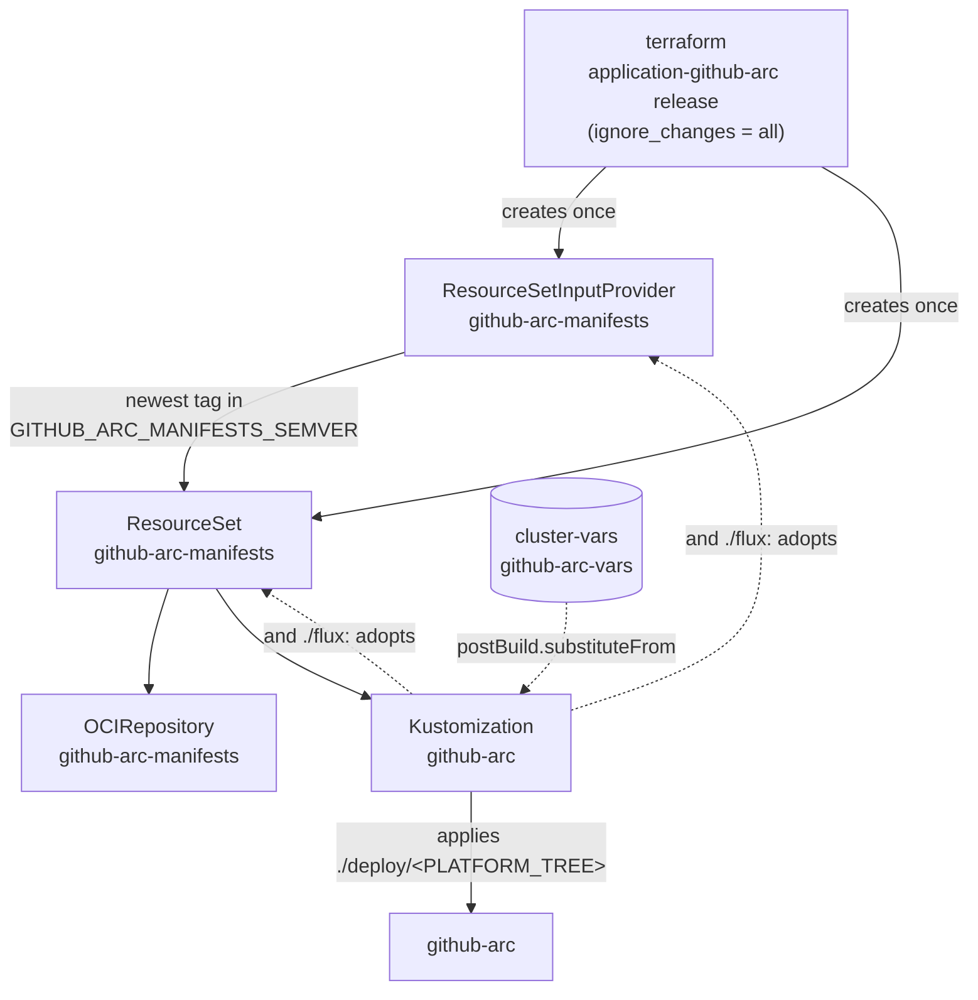

# The seed contract

The cluster modules' `modules/application` creates two objects in `flux-system`, bootstrap-only: the
`application-github-arc` helm release, under `ignore_changes = all`. This image ships the same two objects under
`manifests/flux/`, so the first reconcile adopts them. Their names are a fixed contract between the three repositories:

| Object                     | Name                   | Namespace     | Owner after hand-over              |
| -------------------------- | ---------------------- | ------------- | ---------------------------------- |
| `ResourceSetInputProvider` | `github-arc-manifests` | `flux-system` | `Kustomization/github-arc`         |
| `ResourceSet`              | `github-arc-manifests` | `flux-system` | `Kustomization/github-arc`         |
| `OCIRepository`            | `github-arc-manifests` | `flux-system` | `ResourceSet/github-arc-manifests` |
| `Kustomization`            | `github-arc`           | `flux-system` | `ResourceSet/github-arc-manifests` |
| `ConfigMap` (substitution) | `cluster-vars`         | `flux-system` | terraform (the cluster root)       |
| `ConfigMap` (substitution) | `github-arc-vars`      | `flux-system` | terraform (`modules/{aws,google}`) |

## How the hand-over works

- **The provider follows version tags.** `GITHUB_ARC_MANIFESTS_SEMVER` (default `<1.0.0 >=0.1.0`) selects the image
  tags. The ResourceSet turns the newest match into a digest-pinned, signature-verified `OCIRepository`, and the
  `Kustomization` that applies `./deploy/<PLATFORM_TREE>` from it, substituting from `cluster-vars` and
  `github-arc-vars`.
- **It waits on the platform.** The Kustomization depends on `kyverno-policies` and `arc` everywhere, and on
  `secret-sync` and `karpenter` on aws. The module's seed names the same set, so nothing changes at hand-over.
- **The seed objects can't be pruned.** Both carry `kustomize.toolkit.fluxcd.io/prune: disabled`, in the seed and in the
  image. The Kustomization applies its own parents, and must never be able to prune them: an image that dropped `flux/`
  by mistake would otherwise garbage-collect itself and every github-arc object with it.
- **After hand-over the image owns its own definition.** The semver floor, the `dependsOn` gates, the verify identity
  and the interval all live in the image, so a manifests release changes them with no terraform apply.
- **Destroying the module uninstalls github-arc.** The ResourceSet finalizer garbage-collects the Kustomization, whose
  finalizer prunes the scale sets (and, on aws, the NodePools).

!!! danger "Keep the floor honest"

    A range matching **no** tag empties the ResourceSet, which prunes the application.

## Where it's enforced

`make test` asserts the contract on every tree: `flux-system` must carry exactly the RSIP and ResourceSet
`github-arc-manifests`, both prune-disabled, and `ResourceSet/github-arc-manifests` must emit
`Kustomization/github-arc`. See [Tasks & validation](../reference/tasks.md).
