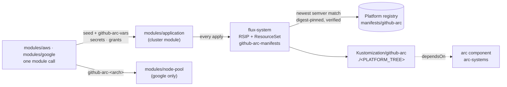

# Overview

github-arc-app-manifests publishes self-hosted GitHub Actions runners as a **application image** for the platform
clusters. The image, `oci://<registry>/manifests/github-arc`, is a cosign-signed OCI artifact holding two
[Actions Runner Controller](https://github.com/actions/actions-runner-controller) scale sets, `linux-amd64` and
`linux-arm64`, their Docker-in-Docker pod template, the GitHub App credential sync and, on aws, their Karpenter
NodePools.

The terraform modules under `modules/` install it onto a cluster as a self-contained application. They seed the image
and pick which builds it follows on every apply. They also create everything it needs outside the cluster - the GitHub
App's secret containers and their read grants, the `github-arc-vars` ConfigMap and, on google, the runners' GKE node
pools - through the cluster modules' generic `modules/application` and `modules/node-pool`. The cluster module itself
has no knowledge of github-arc.

## What a workflow gets

```yaml
jobs:
  build:
    runs-on: linux-arm64 # or linux-amd64
    steps:
      - uses: actions/checkout@v4
      - run: docker build .
```

- **Two labels**, one per architecture: the scale set name is the `runs-on` label.
- **Docker.** Every runner pod carries a `dockerd` sidecar, so `docker build`, `docker run` and container actions work.
- **A fresh pod per job.** ARC runners are ephemeral: each job gets a new pod, and the pod is gone when it ends.
- **Scale to zero.** With no queued jobs there are no runner pods, and the dedicated nodes scale away behind them. The
  first job after an idle spell waits for a node (a minute or two) before it starts.

## What the platform provides

The image builds on three platform contracts, none of which knows github-arc exists:

- the **arc** component (elected in `PLATFORM_COMPONENTS`): the `actions.github.com` CRDs and the controller,
  `arc-systems/arc-gha-rs-controller`, that every scale set names;
- the **mirror**: the `gha-runner-scale-set` chart and the dind image, signed by flux-containers and admitted by the
  platform's `verify-platform-signature` policy (the runner image is this repository's own, `Dockerfile.runner`,
  published beside the manifests);
- the **secret sync** dialect of each cloud, and on aws **Karpenter** with its shared `EC2NodeClass default`.

## Where it sits



Next: [Installing github-arc](installing.md).
